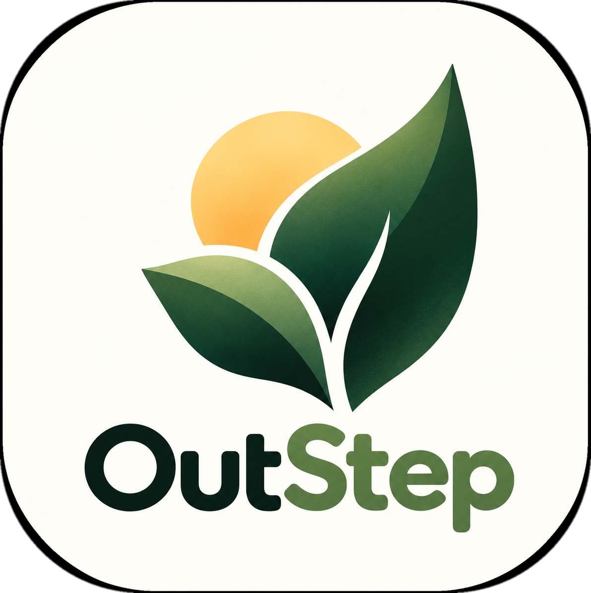

# OutStep

<p align="center">
  
</p>

**Explore. Breathe. Live more.**

OutStep is an open-source, mobile-first AI outdoor companion. You pick what kind of mission you
want, how long you have, and how hard it should be — an open-weight model turns that into a
structured outdoor mission, deterministic safety rules check it, and the app then tracks your
progress while your phone stays in your pocket.

> **The AI plans the adventure. The app tracks the adventure. The human experiences the adventure.**

Built for the **Hacktoberfest Open-Source AI Challenge 2026 — Week 1: Touch Grass**.

---

## Status

Version 0.1 — a complete, working core journey:

- ✅ Preference-based mission generation (activity · duration · energy · difficulty · extra context)
- ✅ Real AI generation through a replaceable provider (Ollama locally, any OpenAI-compatible endpoint remotely)
- ✅ Deterministic Pydantic validation + safety checks (durations, public-outdoor suitability, no trespassing/danger)
- ✅ Polished mobile-first UI: setup → loading → mission card → screen-free activity view → summary → history
- ✅ Timestamp-based task tracking: start/pause/resume/skip/end early, overtime never fails a run
- ✅ `localStorage` persistence of the active mission and history (refresh-safe)
- ✅ Python test suite (mission validation, timing logic, API, providers) and JS timing tests
- ✅ Production build served by the backend from one service; Render/Docker configuration included

Out of scope for this version (on purpose): authentication, social features, GPS, weather, voice.

---

## Quick start (local development)

You need **Python 3.11+**, **Node 20+**, and — for AI generation — [Ollama](https://ollama.com).

### 1. Backend (FastAPI, port 8000)

```bash
python -m venv .venv
# Windows:  .venv\Scripts\activate      macOS/Linux:  source .venv/bin/activate
pip install -r requirements.txt
uvicorn backend.main:app --reload --port 8000
```

### 2. AI provider (pick one)

**Option A — Ollama (local, default, works offline once the model is pulled):**

```bash
ollama pull llama3.2     # ~2 GB, default model used by OutStep
uvicorn backend.main:app --reload --port 8000   # restart so it picks up config
```

**Option B — remote OpenAI-compatible endpoint:**

```bash
cp .env.example .env     # then edit .env — never commit it
# AI_PROVIDER=openai
# OPENAI_BASE_URL=https://api.your-provider.com/v1
# OPENAI_API_KEY=...      (server-side only, never sent to the browser)
# OPENAI_MODEL=your-model
```

### 3. Frontend (Vite + React, port 5173)

```bash
npm install
npm run dev
```

Open **http://localhost:5173** — the dev server proxies `/api` to `http://localhost:8000`.

### 4. Tests

```bash
pytest backend/tests -q     # validation, timing, API, providers
npm test                    # browser timing logic (mirrors backend/timing.py)
```

---

## How a mission works

1. **Choose** — Explore Nature / Move / Clear My Head / Observe, then 15/30/60 minutes, energy,
   difficulty, and optional free-text context.
2. **Generate** — `POST /api/generate-mission` first picks a **mission archetype** for the
   generation (Visual Detective, Nature Bingo, Urban Archaeologist, Colour Quest, Pattern
   Breaker, Sound Mapper, Route Quest, Micro-Explorer, Movement Quest — matched to the chosen
   activity/energy, drawn at random among the best fits so repeats stay fresh). The configured
   open-weight model then writes a strict JSON mission in that style: catchy title, short
   narrative hook (`description`), one-sentence `objective`, and 3–5 tasks with target minutes,
   completion mode (`manual` or `timer`), and safety notes.
3. **Validate** — Pydantic schema checks plus deterministic quality rules:
   - every task must carry a **concrete objective** (a count, comparison, deliverable verb or
     named target) — "notice your surroundings" / "listen to the sounds" filler is rejected;
   - no two tasks may be **rewordings of one another** (tasks are reduced to canonical
     action/object tokens and compared pairwise);
   - task durations must be 1–45 min and add up consistently to the requested total (80–120%);
   - the mission must respect the requested **activity, energy and difficulty** (e.g. high
     energy needs a real-effort task, low energy may not sprint);
   - instructions must be doable outdoors in public, and dangerous/trespassing/illegal
     content is rejected.
   Invalid output gets **repair retries** fed with the exact issues; if it still fails, you get
   a clear error — never a fake mission.
4. **Run** — the mission card turns into a screen-free dusk-themed activity view. You start,
   complete, or skip tasks, pause/resume, end early, or keep going past the planned time.
   Elapsed time is always computed from **saved timestamps**, not from a ticking counter, so a
   refresh or a suspended tab can't corrupt progress. Everything lives in `localStorage`.
5. **Finish** — completion summary (time outside, tasks completed/skipped, whether you ran past
   the planned time — reported as a fact, never a failure) plus an optional reflection, stored
   on-device. History stays in your browser.

**No AI is required once a mission starts.** Generation is the only step that touches the network.

### Sample mission (explicitly not AI)

The **“Skip the AI — show me the sample mission”** button fetches `/api/sample-mission`, which
returns a bundled mission labelled `source: "sample"` and badged in the UI as
**“Sample mission · not AI-generated”**. It exists so the interface can be tested without a
model. It is never presented as AI output.

---

## Repository structure

```
.
├── backend/
│   ├── main.py          # FastAPI app: API routes + serving the built frontend
│   ├── config.py        # env-driven settings (provider, model, keys, CORS)
│   ├── schemas.py       # Pydantic models: request + mission contract (incl. archetype)
│   ├── archetypes.py    # the 9 mission archetypes + per-generation selection
│   ├── validation.py    # deterministic validation, quality gates, safety scan, sample mission
│   ├── providers.py     # Ollama / OpenAI-compatible providers + generation loop
│   ├── timing.py        # pure time math (mirrored by frontend/src/lib/timing.js)
│   └── tests/           # pytest suite (validation, timing, API, providers)
├── frontend/
│   ├── index.html         # head: favicon, apple-touch-icon, PWA manifest link
│   ├── public/            # brand assets: logo, leaf-and-sun mark, PWA icons, manifest
│   └── src/
│       ├── App.jsx              # view state machine + run lifecycle
│       ├── api.js               # backend client (no keys, ever)
│       ├── storage.js           # localStorage persistence
│       ├── constants.js         # activities, durations, energy, difficulty, archetypes
│       ├── lib/timing.js        # timestamp math, mirrors backend/timing.py
│       ├── lib/mission.js       # mission display helpers (archetype, objective, totals)
│       ├── components/          # Setup, Generating, MissionCard, Active, Summary, History, Icons
│       └── styles.css           # OutStep design system (paper → dusk themes)
├── dist/                # production build output (generated, git-ignored)
├── requirements.txt     # FastAPI, Pydantic, httpx, uvicorn, pytest
├── package.json         # React + Vite, lockfile committed
├── vite.config.js       # dev proxy → :8000, build → dist/
├── .env.example         # all configuration, no secrets
├── render.yaml          # Render Blueprint (Docker, one service)
├── Dockerfile           # multi-stage: npm build → python runtime
└── LICENSE              # MIT (application code)
```

---

## Production build (one service)

The backend serves the built frontend from the same process:

```bash
npm run build                 # emits ./dist
uvicorn backend.main:app --port 8000
```

Then `http://localhost:8000` serves the app **and** the API (SPA fallback for client routes,
real 404s for missing assets).

---

## Deploying to Render

`render.yaml` describes a single **Docker** web service (builds the Vite bundle in the image,
then runs Uvicorn):

1. Push the repository to GitHub.
2. In Render: **New → Blueprint**, select the repo — `render.yaml` is picked up automatically.
3. Set these in the service's **Environment** tab (they are `sync: false` on purpose):
   - `AI_PROVIDER=openai`
   - `OPENAI_BASE_URL=https://api.your-provider.com/v1`
   - `OPENAI_API_KEY` ← the secret
   - `OPENAI_MODEL=<model-name>`
4. Deploy. Health check: `/api/health`.

Docker image build (equivalent to what Render runs):

```bash
docker build -t outstep .
docker run -p 10000:10000 -e AI_PROVIDER=ollama -e OLLAMA_BASE_URL=http://host.docker.internal:11434 outstep
```

> For remote generation on Render, point `OPENAI_BASE_URL` at any service exposing the OpenAI
> `/v1/chat/completions` API (hosted open-weight providers work: Groq, Together, OpenRouter,
> Fireworks, a self-hosted vLLM, …). Ollama only makes sense on your own machine.

---

## Models and licences

| Role | Model (default / example) | Upstream licence | Notes |
| --- | --- | --- | --- |
| Local default | `llama3.2` (3B, via Ollama) | **Meta Llama 3.2 Community License** | Free to use & distribute; review the terms (Meta's acceptable-use policy applies). |
| Open-weight alternative | `qwen2.5:3b` (via Ollama) | **Apache License 2.0** | Set `OLLAMA_MODEL=qwen2.5:3b` if you prefer a permissively licensed model. |
| Remote endpoint | any model name your provider serves (e.g. `gpt-4o-mini` as an example default) | Depends on the provider | Set `OPENAI_MODEL` + `OPENAI_BASE_URL`; hosted models are **not** open-weight. |

- **OutStep's own code is MIT** — see `LICENSE`.
- Model weights are **not** part of this repository; you download/point to them separately, and
  their upstream licences govern them.
- The prompt asks for JSON; output quality (and therefore how often the validation retry fires)
  depends on the model you choose. Smaller models may occasionally fail validation — the app
  reports that honestly instead of substituting fake content.

---

## Offline & privacy limitations (honest version)

- **On-device by design:** active missions, task states, history, and reflections live only in
  your browser's `localStorage`. No accounts, no analytics, no server-side user data.
- **AI needs a network/provider:** mission generation requires the configured Ollama instance or
  remote endpoint to be reachable. Failures surface as clear 502 errors with details.
- **Once a mission starts, it's fully local:** timers, pausing, skipping, and the summary make
  zero network calls, so a mission keeps working if you lose connectivity mid-walk.
- **Not yet cached offline:** there is no service worker, so reloading the page without any
  connectivity may fail before the app can restore your saved run. Progress itself is safe in
  `localStorage`.
- **No GPS/weather/voice:** OutStep deliberately plans around ordinary public places without
  tracking you.

---

## API

| Method | Path | Purpose |
| --- | --- | --- |
| `GET` | `/api/health` | Liveness + configured provider/model |
| `GET` | `/api/config` | Non-secret UI config (`provider_label`, `sample_available`) |
| `POST` | `/api/generate-mission` | Generate **and validate** a mission (`502` with `detail.message`/`issues` on failure) |
| `GET` | `/api/sample-mission` | Bundled sample mission (`source: "sample"`) |
| `POST` | `/api/summarize` | Mirror of the summary rules (shared with timing tests) |

Error shape: `{ "detail": { "message": "...", "issues": [{ "field": "...", "message": "..." }] } }`.

---

## Contributing

Issues and PRs are welcome — especially around new mission activities, validation rules, and
accessibility. Please run both test suites (`pytest` and `npm test`) before opening a PR, and
never commit secrets (`.env` is git-ignored; use `.env.example` as the template).

## License

MIT — see `LICENSE`. Model weights follow their upstream licences (see above).
